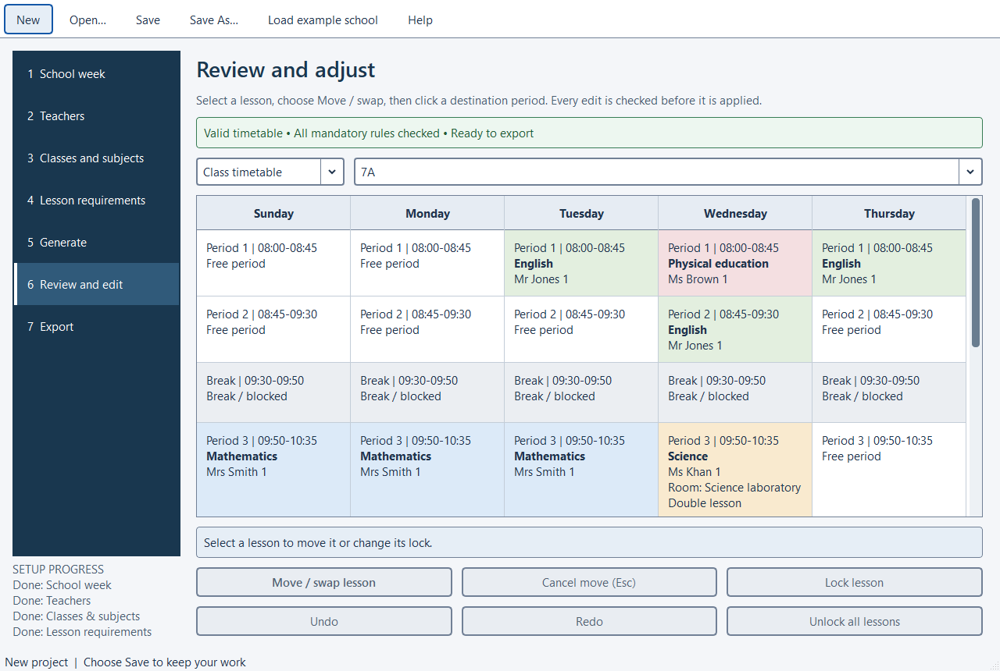

# school-timetable

School Timetable is an offline Windows desktop planner for a secondary-school headteacher.
Configure the week and teaching requirements, generate a clash-free timetable, adjust
and lock lessons, save a portable project and export class/teacher timetables.

Requires Windows 10 version 1809 or later, x64 (Windows 11 recommended). Packaged users
need no Python, account, Excel, administrator rights or network connection.

Development uses Python 3.12 x64. See [CONTRIBUTING.md](CONTRIBUTING.md) for the pinned
environment and check commands, [the specification](docs/specification.md) for scope,
and [the implementation plan](docs/implementation-plan.md) for milestone status.

```powershell
python -m venv .venv
.venv\Scripts\python -m pip install -r requirements-dev.txt
.venv\Scripts\python -m pip install --no-deps --no-build-isolation -e .
.venv\Scripts\python -m pytest
.venv\Scripts\python -m school_timetable
```

Synthetic example project files are in `examples/`. Real school files, exports,
logs and distribution bundles are ignored by Git.

See the [plain-English user guide](src/school_timetable/resources/guide.md) (also available
inside Help). The synthetic example is available from **Load example school**. All
class, teacher and school views use the current edited schedule. Search outcomes are
reported separately; a feasible result is usable before preferences are fully optimized.



Architecture: `models` and `validation` are independent of Qt; `scheduler` contains
the CP-SAT model; `storage` handles strict JSON/atomic files; `editing` applies atomic
validated moves/swaps; `views` projects the schedule; `exports` writes XLSX and Qt PDF;
`session` owns document revisions/history; `ui` handles the guided desktop workflow.
Local recovery files and rotating logs are in Windows LocalAppData under
`SchoolTimetable/School Timetable`. User projects are saved wherever the user chooses.

Build Windows delivery with `powershell -ExecutionPolicy Bypass -File scripts/build-windows.ps1`.
The ZIP is `dist/SchoolTimetable-1.0.0-windows-x64.zip`; extract the whole ZIP and open
SchoolTimetable.exe. See [Windows build details](docs/windows-build.md),
[actual verification](docs/verification.md), and [observed larger-school timing](docs/performance.md).

The desktop uses one readable light appearance under both Windows light and dark
settings. See the [interface before/after evidence and scaling checks](docs/ui-verification.md).
